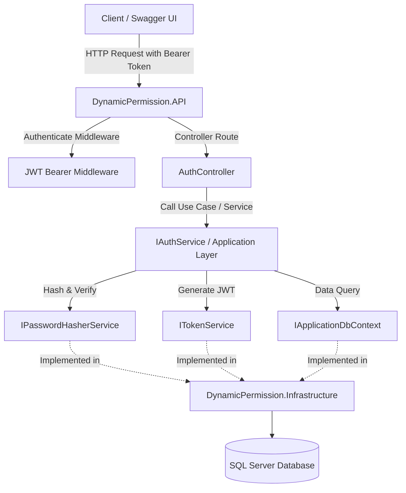

# KẾ HOẠCH TRIỂN KHAI HỆ THỐNG AUTHENTICATION (JWT BEARER)
## DỰ ÁN DYNAMIC PERMISSION

---

## 1. TỔNG QUAN & NGUYÊN TẮC THIẾT KẾ

Kế hoạch này phác thảo chi tiết kiến trúc, các thành phần và quy trình triển khai hệ thống Xác thực (Authentication) sử dụng **JWT Bearer Token** kết hợp **Refresh Token** cho dự án `DynamicPermission`.

### Các nguyên tắc tuân thủ:
1. **Chuẩn Clean Architecture:**
   - **Domain:** Chứa Entity (`RefreshToken`) và các Entity nghiệp vụ thuần túy, không phụ thuộc framework bên ngoài.
   - **Application:** Chứa Interfaces (`ITokenService`, `IPasswordHasherService`, `ICurrentUserService`, `IApplicationDbContext`), DTOs, Request/Response Validators và Application Services.
   - **Infrastructure:** Triển khai cài đặt cụ thể (`TokenService`, `PasswordHasherService`, cấu hình JWT Options, EF Core Configurations & Migration cho `RefreshToken`).
   - **API:** Chứa `AuthController`, cấu hình Authentication Middleware, Swagger Bearer Auth và xử lý lỗi Unauthorized/Forbidden theo chuẩn RFC 7807.
2. **Nguyên tắc JWT bảo mật cao:**
   - **UserId** (`Guid`) làm định danh chính trong claim (`ClaimTypes.NameIdentifier` / `JwtRegisteredClaimNames.Sub`).
   - Có đầy đủ `Issuer`, `Audience`, `Expiration`.
   - **Tuyệt đối KHÔNG lưu Permission vào JWT**: Giữ token gọn nhẹ; khi admin thay đổi quyền của User/Role, hệ thống sẽ nhận diện ngay lập tức trong database/cache ở các request tiếp theo mà không cần chờ Access Token hết hạn.
   - Secret Key được nạp qua Configuration (`appsettings.json` / Environment Variable), không hardcode trong mã nguồn.
3. **Cơ chế Refresh Token an toàn:**
   - Hạn chế thời gian sống của Access Token (ngắn: vd 15 - 60 phút).
   - Refresh Token (sống lâu hơn: vd 7 ngày) được lưu trong Database, có thể chủ động thu hồi (`IsRevoked = true`) khi cần đăng xuất hoặc phát hiện bất thường.
4. **Mật khẩu an toàn:**
   - Sử dụng giải thuật băm mật khẩu chuẩn bảo mật công nghiệp (PBKDF2 qua `PasswordHasher<User>` của ASP.NET Core hoặc BCrypt), tự động tạo Salt ngẫu nhiên và chống tấn công timing attack.

---

## 2. KIẾN TRÚC & TỔ CHỨC CÁC THÀNH PHẦN



### Chi tiết các file sẽ được tạo/cập nhật theo từng tầng:

### 2.1. Domain Layer (`DynamicPermission.Domain`)
* Thêm thực thể: `Entities/RefreshToken.cs`
  * `Id` (`Guid`): Khóa chính.
  * `UserId` (`Guid`): FK trỏ tới `Users(Id)`.
  * `Token` (`string`): Chuỗi token ngẫu nhiên bảo mật cao (cryptographically secure random string).
  * `ExpiresAt` (`DateTimeOffset`): Thời điểm hết hạn.
  * `IsRevoked` (`bool`): Trạng thái thu hồi (mặc định `false`).
  * `RevokedAt` (`DateTimeOffset?`): Thời điểm bị thu hồi.
  * *Audit fields:* `CreatedAt`, `CreatedBy`.
  * *Navigation:* `User User`.
* Cập nhật `Entities/User.cs`: Thêm quan hệ `ICollection<RefreshToken> RefreshTokens`.

---

### 2.2. Application Layer (`DynamicPermission.Application`)
* **Contracts / Interfaces:**
  * `Common/Interfaces/IApplicationDbContext.cs`: Trừu tượng hóa DbContext cho Application layer (`DbSet<User>`, `DbSet<Role>`, `DbSet<RefreshToken>`, `SaveChangesAsync`).
  * `Common/Interfaces/ITokenService.cs`: 
    * `GenerateAccessToken(User user, string roleCode)`: Tạo JWT Access Token.
    * `GenerateRefreshToken(Guid userId)`: Tạo Refresh Token ngẫu nhiên an toàn.
  * `Common/Interfaces/IPasswordHasherService.cs`:
    * `HashPassword(User user, string password)`: Băm mật khẩu.
    * `VerifyPassword(User user, string password, string passwordHash)`: Kiểm tra tính hợp lệ.
  * `Common/Interfaces/ICurrentUserService.cs`: Trích xuất `UserId`, `Username`, `Role` từ Claims của request hiện tại.
  * `Services/IAuthService.cs`: Định nghĩa nghiệp vụ xác thực.
* **DTOs & Models (`Models/Auth/`):**
  * `LoginRequest.cs` (`UsernameOrEmail`, `Password`)
  * `LoginResponse.cs` (`AccessToken`, `RefreshToken`, `ExpiresIn`, `TokenType`, `UserInfoDto`)
  * `RegisterUserRequest.cs` (`Username`, `Email`, `FullName`, `RoleId`, `Password` hoặc để trống để sinh ngẫu nhiên)
  * `RegisterUserResponse.cs` (`UserId`, `Username`, `Email`, `FullName`, `InitialPassword`)
  * `RefreshTokenRequest.cs` (`AccessToken`, `RefreshToken`)
  * `RefreshTokenResponse.cs` (`AccessToken`, `RefreshToken`, `ExpiresIn`)
  * `ResetPasswordRequest.cs` (`UserId`, `NewPassword` tùy chọn)
  * `ResetPasswordResponse.cs` (`UserId`, `Username`, `NewPassword`)
  * `CurrentUserDto.cs` (`Id`, `Username`, `Email`, `FullName`, `RoleCode`, `RoleName`, `IsActive`)
* **Triển khai nghiệp vụ (`Services/AuthService.cs`):**
  * Logic đăng nhập, xác thực mật khẩu, kiểm tra trạng thái `IsActive` của User và Role.
  * Logic đăng ký user mới (chỉ thực hiện bởi user có quyền).
  * Logic reset mật khẩu (sinh mật khẩu ngẫu nhiên an toàn hoặc theo chỉ định, lưu hash, trả về mật khẩu mới).
  * Logic đổi mới token (`RefreshToken`).

---

### 2.3. Infrastructure Layer (`DynamicPermission.Infrastructure`)
* **Cấu hình & Dịch vụ:**
  * `Authentication/JwtSettings.cs`: Model ánh xạ cấu hình JWT (`SecretKey`, `Issuer`, `Audience`, `AccessTokenExpirationMinutes`, `RefreshTokenExpirationDays`).
  * `Authentication/TokenService.cs`: Triển khai sinh JWT Token qua `System.IdentityModel.Tokens.Jwt` và sinh RefreshToken qua `RandomNumberGenerator`.
  * `Authentication/PasswordHasherService.cs`: Triển khai băm mật khẩu an toàn sử dụng `Microsoft.AspNetCore.Identity.PasswordHasher<User>`.
  * `Services/CurrentUserService.cs`: Triển khai `ICurrentUserService` thông qua `IHttpContextAccessor`.
* **Database & EF Core:**
  * `Persistence/Configurations/RefreshTokenConfiguration.cs`: Cấu hình bảng `RefreshTokens` (PK, FK, Unique Index trên `Token`).
  * Cập nhật `DynamicPermissionDbContext`: Kế thừa `IApplicationDbContext`, thêm `DbSet<RefreshToken> RefreshTokens`.
  * **Tạo Migration mới:** `AddRefreshTokenTable`.
* **Dependency Injection:**
  * Bổ sung đăng ký JWT Bearer Authentication, TokenService, PasswordHasher, CurrentUserService vào `DependencyInjection.cs`.

---

### 2.4. API Layer (`DynamicPermission.API`)
* **Controllers/AuthController.cs:**
  1. `POST /api/auth/login` (Anonymous): Đăng nhập, nhận Access Token & Refresh Token.
  2. `POST /api/auth/refresh-token` (Anonymous): Đổi Refresh Token lấy Access Token mới.
  3. `GET /api/auth/me` (`[Authorize]`): Lấy thông tin tài khoản đang đăng nhập.
  4. `POST /api/auth/register` (`[Authorize]`): Đăng ký tài khoản mới (dành cho người quản trị có quyền).
  5. `POST /api/auth/reset-password` (`[Authorize]`): Reset mật khẩu của một tài khoản (dành cho người quản trị có quyền).
* **Cấu hình Swagger (`Program.cs`):**
  * Thêm cấu hình `AddSecurityDefinition("Bearer", ...)` và `AddSecurityRequirement(...)` để Swagger UI có nút **Authorize** nhập token `Bearer {token}` test trực tiếp.
* **Xử lý lỗi Unauthorized (401) & Forbidden (403):**
  * Cấu hình sự kiện `JwtBearerEvents`:
    * `OnChallenge`: Khi request không có token hoặc token không hợp lệ $\rightarrow$ trả về định dạng JSON chuẩn (mã 401, thông điệp rõ ràng).
    * `OnForbidden`: Khi request không đủ quyền $\rightarrow$ trả về mã 403 cùng JSON thông báo.
* **Cấu hình Middleware:**
  * `app.UseAuthentication();`
  * `app.UseAuthorization();`

---

## 3. THIẾT KẾ CHI TIẾT CÁC ENDPOINT

### 3.1. `POST /api/auth/login`
* **Mục đích:** Đăng nhập hệ thống.
* **Quyền:** Anonymous (Công khai).
* **Input Validation:**
  * `UsernameOrEmail`: Bắt buộc, không rỗng.
  * `Password`: Bắt buộc, không rỗng.
* **Xử lý nghiệp vụ:**
  1. Tìm User theo `Username` hoặc `Email` kèm theo thông tin `Role`.
  2. Nếu không tìm thấy: Trả về `401 Unauthorized` ("Tên đăng nhập hoặc mật khẩu không chính xác").
  3. Kiểm tra mật khẩu qua `IPasswordHasherService.VerifyPassword`:
     * Nếu sai: Trả về `401 Unauthorized`.
  4. **Kiểm tra trạng thái Active:**
     * Nếu `User.IsActive == false`: Trả về `403 Forbidden` ("Tài khoản đã bị vô hiệu hóa hoặc khóa tạm thời").
     * Nếu `Role.IsActive == false`: Trả về `403 Forbidden` ("Vai trò của tài khoản hiện đang bị tạm ngừng").
  5. Sinh **Access Token (JWT)** chứa:
     * `Sub` / `NameIdentifier`: `User.Id`
     * `UniqueName`: `User.Username`
     * `Email`: `User.Email`
     * `Role`: `Role.Code`
     * `Jti`: GUID duy nhất của token
     * `Iss`: Issuer từ cấu hình
     * `Aud`: Audience từ cấu hình
     * *KHÔNG chứa Permission*
  6. Sinh **Refresh Token** ngẫu nhiên, lưu vào bảng `RefreshTokens`.
  7. Trả về mã HTTP 200 kèm `LoginResponse`.

---

### 3.2. `POST /api/auth/refresh-token`
* **Mục đích:** Cấp mới Access Token khi token cũ sắp hoặc đã hết hạn mà người dùng không cần nhập lại mật khẩu.
* **Quyền:** Anonymous.
* **Xử lý nghiệp vụ:**
  1. Nhận `AccessToken` và `RefreshToken`.
  2. Trích xuất `UserId` từ `AccessToken` (bỏ qua kiểm tra thời gian hết hạn của token).
  3. Tìm bản ghi `RefreshToken` hợp lệ trong DB thỏa mãn:
     * `Token == request.RefreshToken`
     * `UserId == userId`
     * `IsRevoked == false`
     * `ExpiresAt > DateTimeOffset.UtcNow`
  4. Nếu không hợp lệ: Trả về `401 Unauthorized` ("Refresh token không hợp lệ hoặc đã hết hạn").
  5. Đánh dấu thu hồi Refresh Token cũ (`IsRevoked = true`), sinh Refresh Token mới và Access Token mới (Cơ chế *Refresh Token Rotation* chống lộ token).
  6. Trả về mã HTTP 200 kèm `RefreshTokenResponse`.

---

### 3.3. `GET /api/auth/me`
* **Mục đích:** Lấy thông tin hồ sơ của tài khoản đang đăng nhập.
* **Quyền:** Yêu cầu đăng nhập (`[Authorize]`).
* **Xử lý nghiệp vụ:**
  1. Lấy `UserId` từ `ICurrentUserService` (được đọc từ Claims của JWT).
  2. Truy vấn Database lấy thông tin chi tiết của User và Role.
  3. Trả về thông tin: `Id`, `Username`, `Email`, `FullName`, `RoleCode`, `RoleName`, `IsActive`.

---

### 3.4. `POST /api/auth/register`
* **Mục đích:** Tạo mới tài khoản người dùng trong hệ thống.
* **Quyền:** Yêu cầu quyền quản trị (`[Authorize]`). *(Giai đoạn sau sẽ gắn Dynamic Permission `user.create`)*.
* **Input Validation:**
  * `Username`: 3 - 50 ký tự, không chứa ký tự đặc biệt.
  * `Email`: Đúng định dạng email hợp lệ.
  * `FullName`: Bắt buộc.
  * `RoleId`: Phải tồn tại và đang `IsActive = true` trong database.
* **Xử lý nghiệp vụ:**
  1. Kiểm tra trùng lặp `Username` hoặc `Email` trong Database. Nếu trùng, trả về `400 Bad Request`.
  2. Nếu người gọi không chỉ định mật khẩu: Tự động sinh mật khẩu tạm thời ngẫu nhiên độ an toàn cao (12 ký tự gồm chữ hoa, chữ thường, số và ký tự đặc biệt).
  3. Băm mật khẩu qua `IPasswordHasherService`.
  4. Tạo bản ghi `User` với `RoleId` được chỉ định, lưu vào DB.
  5. Trả về mã HTTP 201 Created cùng thông tin tài khoản và mật khẩu khởi tạo để gửi cho người dùng.

---

### 3.5. `POST /api/auth/reset-password`
* **Mục đích:** Reset mật khẩu tài khoản (dành cho quản trị viên khi người dùng quên mật khẩu hoặc cần cấp lại).
* **Quyền:** Yêu cầu quyền quản trị (`[Authorize]`). *(Giai đoạn sau sẽ gắn Dynamic Permission `user.reset_password`)*.
* **Xử lý nghiệp vụ:**
  1. Tìm `User` theo `UserId`. Nếu không tìm thấy, trả về `404 Not Found`.
  2. Nếu không truyền mật khẩu mới: Tự động sinh mật khẩu ngẫu nhiên an toàn mới.
  3. Băm mật khẩu mới và cập nhật `PasswordHash` của User.
  4. Vô hiệu hóa toàn bộ `RefreshTokens` hiện có của User này (buộc User phải đăng nhập lại trên tất cả thiết bị bằng mật khẩu mới).
  5. Lưu vào Database và trả về mật khẩu mới để bàn giao cho người dùng.

---

## 4. CẤU HÌNH BẢO MẬT & JWT SETTINGS

### Cấu hình trong `appsettings.json`:
```json
{
  "JwtSettings": {
    "SecretKey": "SuperSecretKey_DynamicPermission_ReplaceInProduction_MinLength32Chars!",
    "Issuer": "DynamicPermissionAPI",
    "Audience": "DynamicPermissionClient",
    "AccessTokenExpirationMinutes": 60,
    "RefreshTokenExpirationDays": 7
  }
}
```
* `SecretKey` có độ dài tối thiểu 256 bits (32 bytes) để đảm bảo chuẩn giải thuật `HmacSha256`.
* Hỗ trợ nạp ghi đè bằng Environment Variable khi deploy production: `JwtSettings__SecretKey`.

### Xử lý lỗi Unauthorized tùy biến (Custom OnChallenge & OnForbidden):
Khi không có Token hoặc Token hết hạn, API trả về JSON nhất quán thay vì trả về trang lỗi HTML mặc định của web server:
```json
{
  "status": 401,
  "title": "Unauthorized",
  "detail": "Bạn chưa đăng nhập hoặc phiên làm việc đã hết hạn. Vui lòng cung cấp Access Token hợp lệ.",
  "timestamp": "2026-11-10T09:30:00Z"
}
```

---

## 5. THIẾT KẾ DATABASE BỔ SUNG: BẢNG `RefreshTokens`

| Tên cột | Kiểu dữ liệu | Nullable | Ràng buộc / Index | Ghi chú |
| :--- | :--- | :---: | :--- | :--- |
| `Id` | `uniqueidentifier` | No | **PK (Clustered)** | Định danh bản ghi token |
| `UserId` | `uniqueidentifier` | No | **FK, Index** | Khóa ngoại trỏ tới `Users(Id)` |
| `Token` | `varchar(200)` | No | **Unique Index** | Chuỗi token ngẫu nhiên bảo mật |
| `ExpiresAt` | `datetimeoffset` | No | **Index** | Thời điểm hết hạn |
| `IsRevoked` | `bit` | No | Default `0` | Trạng thái thu hồi |
| `RevokedAt` | `datetimeoffset` | Yes | | Thời điểm bị thu hồi |
| `CreatedAt` | `datetimeoffset` | No | Default `SYSDATETIMEOFFSET()` | Thời điểm tạo |
| `CreatedBy` | `nvarchar(100)` | Yes | | Người tạo / Client |

---

## 6. KẾ HOẠCH BƯỚC TRIỂN KHAI (STEP-BY-STEP WORKFLOW)

Sau khi được người dùng phê duyệt kế hoạch, các bước thực hiện sẽ lần lượt như sau:

1. **Bước 1 (Domain):** Thêm entity `RefreshToken` và cập nhật quan hệ trên `User`.
2. **Bước 2 (Application):**
   * Định nghĩa các interface: `IApplicationDbContext`, `ITokenService`, `IPasswordHasherService`, `ICurrentUserService`, `IAuthService`.
   * Tạo các DTOs cho Login, Register, RefreshToken, ResetPassword, Me.
   * Viết class triển khai `AuthService`.
3. **Bước 3 (Infrastructure):**
   * Cài đặt `TokenService` (sinh JWT và Refresh Token).
   * Cài đặt `PasswordHasherService` (băm mật khẩu chuẩn ASP.NET Core).
   * Tạo `RefreshTokenConfiguration` và cập nhật `DynamicPermissionDbContext`.
   * Cấu hình JWT Bearer Authentication và đăng ký các dịch vụ trong `DependencyInjection.cs`.
   * Tạo Migration `AddRefreshTokenTable`.
4. **Bước 4 (API):**
   * Cập nhật `appsettings.json` với cấu hình `JwtSettings`.
   * Cập nhật `Program.cs` cấu hình Swagger hỗ trợ nhập JWT Bearer Token, middleware `UseAuthentication()` và `UseAuthorization()`.
   * Tạo `AuthController` với đủ 5 endpoints.
5. **Bước 5 (Kiểm thử):**
   * Build kiểm tra lỗi biên dịch (`dotnet build`).
   * Khởi chạy ứng dụng và cung cấp hướng dẫn kèm tài liệu ví dụ request/response cho cURL, Swagger và Postman.
