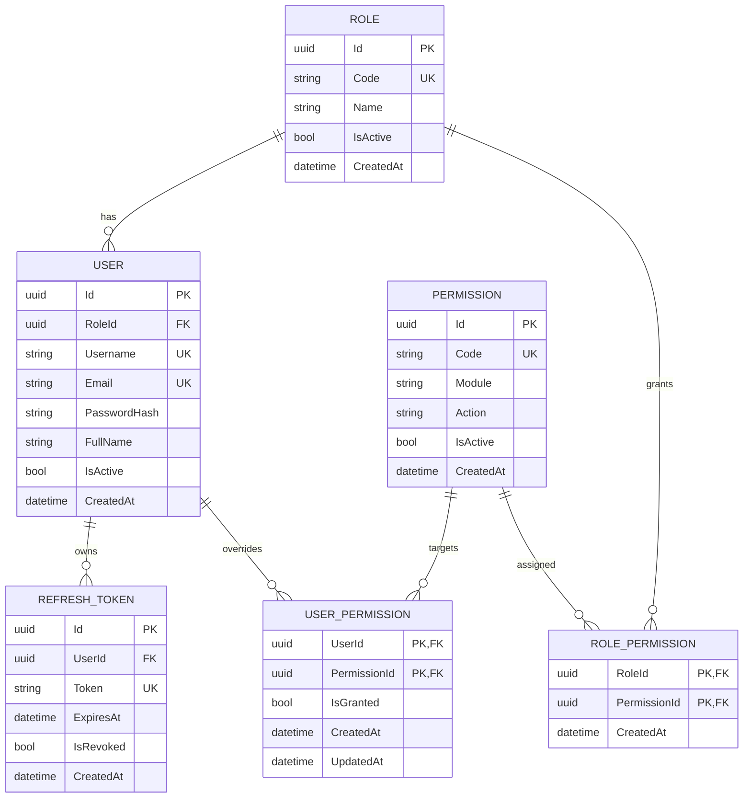

# Dynamic Permission database diagram

## Permission evaluation

- Each `USER` has exactly one required `RoleId`; one `ROLE` can be assigned to many users.
- `ROLE_PERMISSION` is the many-to-many join between roles and permissions. Its composite key prevents duplicate assignment of the same permission to a role.
- `USER_PERMISSION` is a direct grant/deny override. Its composite key prevents duplicate override rows for the same user and permission.
- A user's effective permission set is derived from its active role's active permissions plus active direct grants, then direct denies are removed. Inactive users, roles, and permissions do not authorize requests.
- The current schema does not model many roles per user or a user without a role. Supporting either behavior would require an explicit domain/schema change and migration; these were not introduced as part of this test task.
