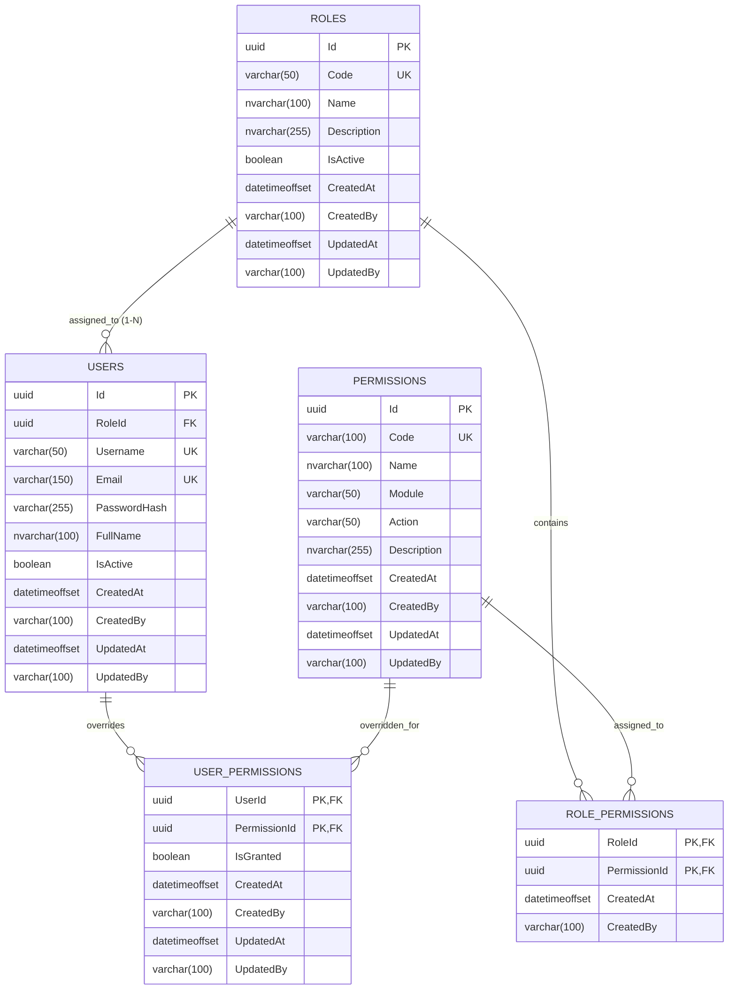

# TÀI LIỆU THIẾT KẾ DOMAIN MODEL & DATABASE
## HỆ THỐNG PHÂN QUYỀN ĐỘNG (DYNAMIC PERMISSION) - MÔ HÌNH 1 USER : 1 ROLE

---

## 1. TỔNG QUAN & NGUYÊN TẮC THIẾT KẾ

Tài liệu này định nghĩa cấu trúc Domain Model và Database Schema cho hệ thống Phân quyền Động (Dynamic Permission) theo mô hình **1 User chỉ thuộc về 1 Role duy nhất**.

### Tiêu chí thiết kế:
* **Tối giản & Tối ưu truy vấn (KISS):** Loại bỏ hoàn toàn bảng trung gian `UserRole`. `RoleId` được lưu trực tiếp tại bảng `User`, giảm bớt một phép `JOIN` trong mọi truy vấn kiểm tra quyền.
* **Không xóa vật lý User & Role (No Hard Delete):** Tuyệt đối không xóa dữ liệu User và Role ra khỏi Database. Khi cần ngừng hoạt động hoặc thu hồi quyền, chỉ chuyển đổi trạng thái `IsActive` (`true` -> `false`). Điều này giúp toàn vẹn lịch sử kiểm toán (Audit Trail) và an toàn tuyệt đối cho các quan hệ khóa ngoại.
* **Linh hoạt cao (User-level Permission Override):** Mặc dù 1 User chỉ có 1 Role, hệ thống vẫn hỗ trợ gán thêm (Grant) hoặc tước bỏ (Deny) quyền riêng lẻ cho từng User mà không cần thay đổi cấu trúc của Role.
* **Toàn vẹn dữ liệu (Data Integrity):** Ngăn chặn triệt để trùng lặp gán quyền thông qua Foreign Key và Composite Primary Key.
* **Dễ mở rộng (Extensible):** Hỗ trợ phân nhóm `Module` và `Action` cho Permission mà không cần tạo quan hệ bảng phức tạp ở giai đoạn đầu.
* **Audit Trail:** Lưu vết đầy đủ thông tin ai tạo, ai sửa, thời gian tạo và thời gian sửa.

---

## 2. KIẾN TRÚC THỰC THỂ TRONG DOMAIN (DOMAIN ENTITIES)

### 2.1. Lớp cơ sở (Base / Auditable Entities)

```csharp
// Thực thể cơ sở có Audit đầy đủ (áp dụng cho User, Role, Permission)
public abstract class AuditableEntity<TKey>
{
    public TKey Id { get; protected set; }
    public DateTimeOffset CreatedAt { get; set; }
    public string? CreatedBy { get; set; }
    public DateTimeOffset? UpdatedAt { get; set; }
    public string? UpdatedBy { get; set; }
}

// Thực thể liên kết Role - Permission (chỉ cần lưu vết ai gán, khi nào gán)
public abstract class AuditableJoinEntity
{
    public DateTimeOffset CreatedAt { get; set; }
    public string? CreatedBy { get; set; }
}
```

---

### 2.2. Danh sách các Domain Entity

#### 1. `User` (Người dùng)
* **Mô tả:** Đại diện cho tài khoản người dùng trong hệ thống. Mỗi User thuộc về **duy nhất 1 Role**.
* **Thuộc tính:**
  * `Id` (`Guid`): Khóa chính định danh người dùng.
  * `Username` (`string`, max 50): Tên đăng nhập duy nhất.
  * `Email` (`string`, max 150): Email duy nhất.
  * `PasswordHash` (`string`, max 255): Mật khẩu đã được băm an toàn (BCrypt / PBKDF2 / Argon2).
  * `FullName` (`string`, max 100): Họ tên hiển thị.
  * `IsActive` (`bool`): Trạng thái hoạt động (`true`: kích hoạt, `false`: tạm khóa).
  * `RoleId` (`Guid`): Khóa ngoại trực tiếp trỏ tới `Role.Id`.
  * *Audit fields:* `CreatedAt`, `CreatedBy`, `UpdatedAt`, `UpdatedBy`.
* **Quan hệ:**
  * `Role Role`: Vai trò duy nhất của User.
  * `IReadOnlyCollection<UserPermission> UserPermissions`: Danh sách các quyền được gán thêm hoặc tước bớt trực tiếp cho User.

#### 2. `Role` (Vai trò / Nhóm quyền)
* **Mô tả:** Tập hợp một nhóm các quyền mặc định (ví dụ: `ADMIN`, `MANAGER`, `STAFF`, `USER`).
* **Thuộc tính:**
  * `Id` (`Guid`): Khóa chính.
  * `Code` (`string`, max 50): Mã định danh vai trò (viết hoa, duy nhất, vd: `ADMIN`, `SALE_MANAGER`).
  * `Name` (`string`, max 100): Tên hiển thị của vai trò.
  * `Description` (`string?`, max 255): Diễn giải chức năng vai trò.
  * `IsActive` (`bool`): Trạng thái hoạt động.
  * *Audit fields:* `CreatedAt`, `CreatedBy`, `UpdatedAt`, `UpdatedBy`.
* **Quan hệ:**
  * `IReadOnlyCollection<User> Users`: Danh sách User thuộc vai trò này (Quan hệ 1 - N).
  * `IReadOnlyCollection<RolePermission> RolePermissions`: Danh sách quyền thuộc vai trò này.

#### 3. `Permission` (Quyền hạn chức năng)
* **Mô tả:** Đại diện cho một hành động cụ thể trên một chức năng/tài nguyên hệ thống.
* **Thuộc tính:**
  * `Id` (`Guid`): Khóa chính.
  * `Code` (`string`, max 100): Mã quyền duy nhất theo cấu trúc `<module>.<action>` (vd: `customer.view`, `customer.create`).
  * `Name` (`string`, max 100): Tên hiển thị dễ hiểu (vd: "Xem khách hàng").
  * `Module` (`string`, max 50): Tên phân hệ phục vụ gom nhóm giao diện (vd: `customer`, `order`, `report`).
  * `Action` (`string`, max 50): Hành động cụ thể (vd: `view`, `create`, `update`, `delete`, `export`).
  * `Description` (`string?`, max 255): Diễn giải chi tiết về quyền hạn.
  * *Audit fields:* `CreatedAt`, `CreatedBy`, `UpdatedAt`, `UpdatedBy`.
* **Quan hệ:**
  * `IReadOnlyCollection<RolePermission> RolePermissions`
  * `IReadOnlyCollection<UserPermission> UserPermissions`

#### 4. `RolePermission` (Bảng liên kết Role - Permission)
* **Mô tả:** Thể hiện quan hệ nhiều - nhiều (N-N) giữa Role và Permission.
* **Thuộc tính:**
  * `RoleId` (`Guid`): FK trỏ tới `Role.Id`.
  * `PermissionId` (`Guid`): FK trỏ tới `Permission.Id`.
  * *Audit fields:* `CreatedAt`, `CreatedBy`.
* **Quan hệ:**
  * `Role`: Điều hướng tới Role.
  * `Permission`: Điều hướng tới Permission.

#### 5. `UserPermission` (Cơ chế Gán/Bỏ quyền trực tiếp cho User - Permission Override)
* **Mô tả:** Cho phép quản trị viên tùy biến quyền cho từng User mà không cần tạo thêm Role mới hoặc sửa Role chung.
* **Thuộc tính:**
  * `UserId` (`Guid`): FK trỏ tới `User.Id`.
  * `PermissionId` (`Guid`): FK trỏ tới `Permission.Id`.
  * `IsGranted` (`bool`):
    * `true` (Grant/Allow): Cấp thêm quyền cho User (kể cả khi Role không có).
    * `false` (Deny/Revoke): Tước bỏ quyền của User (kể cả khi Role đang có).
  * *Audit fields:* `CreatedAt`, `CreatedBy`, `UpdatedAt`, `UpdatedBy`.
* **Quan hệ:**
  * `User`: Điều hướng tới User.
  * `Permission`: Điều hướng tới Permission.

---

## 3. SƠ ĐỒ QUAN HỆ THỰC THỂ (ERD & RELATIONSHIPS)



---

## 4. QUY TẮC NGHIỆP VỤ (BUSINESS RULES)

1. **Ràng buộc 1 User : 1 Role:**
   * Mỗi User bắt buộc phải liên kết với 1 `RoleId` hợp lệ.
   * Khi cần đổi vai trò của User, chỉ cần cập nhật cột `RoleId` trong bảng `Users`.

2. **Nguyên tắc phân quyền hiệu dụng (Effective Permissions Resolution):**
   * Một User chỉ có quyền truy cập khi thỏa mãn đồng thời:
     * `User.IsActive == true`.
   * Nếu `Role.IsActive == false`: Quyền kế thừa từ Role bị vô hiệu hóa hoàn toàn, User chỉ còn giữ lại các quyền được gán trực tiếp (`UserPermission.IsGranted == true`).
   * **Công thức tổng hợp quyền (Priority: Deny > Allow Direct > Role Permissions):**
     $$\text{EffectivePermissions} = \left( \text{RolePermissions}(User.Role) \cup \text{UserDirectGrants} \right) \setminus \text{UserDirectDenies}$$
     * *Bước 1:* Lấy danh sách quyền từ Role của User (nếu Role đang `IsActive = true`).
     * *Bước 2:* Hợp nhất với các quyền có `UserPermission.IsGranted == true` (Gán thêm cho User).
     * *Bước 3:* Loại trừ các quyền có `UserPermission.IsGranted == false` (Tước bớt từ User).

3. **Quy tắc ngăn chặn trùng lặp:**
   * Không thể gán một Permission cho một Role nhiều lần (Composite PK `(RoleId, PermissionId)`).
   * Không thể tạo 2 bản ghi override cho cùng một cặp `(UserId, PermissionId)` (Composite PK `(UserId, PermissionId)`).

4. **Chuẩn đặt tên mã định danh:**
   * `Permission.Code`: Viết thường toàn bộ (`lowercase`), định dạng `<module>.<action>`. Không chứa khoảng trắng hoặc ký tự đặc biệt ngoài dấu chấm (`.`). Ví dụ: `customer.view`, `customer.create`.
   * `Role.Code`: Viết hoa toàn bộ (`UPPERCASE`), phân cách bằng gạch dưới `_`. Ví dụ: `SUPER_ADMIN`, `SALE_MANAGER`.

5. **Nguyên tắc quản lý trạng thái (Không Hard Delete User và Role):**
   * **Tuyệt đối không xóa vật lý (`DELETE FROM Users` / `DELETE FROM Roles`):**
     * Để bảo toàn toàn vẹn dữ liệu, các bảng log/audit và mối quan hệ khóa ngoại, hệ thống áp dụng cơ chế **Vô hiệu hóa trạng thái (`IsActive = false`)**.
     * Khi User nghỉ việc hoặc bị khóa tài khoản: Set `User.IsActive = false`. Tài khoản bị chặn truy cập và mất toàn bộ hiệu lực phân quyền ngay lập tức.
     * Khi Role không còn sử dụng: Set `Role.IsActive = false`. Toàn bộ User đang gắn với Role này sẽ lập tức mất quyền kế thừa từ Role đó mà không cần phải gỡ Role của từng User.
   * **Quản lý dữ liệu ở các bảng liên kết:**
     * `RolePermissions`: Cho phép xóa bản ghi liên kết khi quản trị viên muốn gỡ một quyền ra khỏi Role (hoặc thêm bản ghi khi gắn quyền vào Role).
     * `UserPermissions`: Cho phép cập nhật `IsGranted` hoặc xóa bản ghi override khi muốn User quay trở về tuân thủ hoàn toàn theo quyền mặc định của Role.
     * Khi xóa `Permission` (nếu hệ thống gỡ bỏ hoàn toàn một tính năng phần mềm): Áp dụng Cascade Delete tự động dọn dẹp các liên kết trong `RolePermission` và `UserPermission`.

---

## 5. THIẾT KẾ DATABASE: PRIMARY KEY, FOREIGN KEY & INDEXES

### 5.1. Bảng `Roles`
| Tên cột | Kiểu dữ liệu | Nullable | Ràng buộc / Index | Ghi chú |
| :--- | :--- | :---: | :--- | :--- |
| `Id` | `uniqueidentifier` | No | **PK (Clustered)** | Định danh vai trò |
| `Code` | `varchar(50)` | No | **Unique Index (Non-clustered)** | Mã vai trò (vd: `ADMIN`) |
| `Name` | `nvarchar(100)` | No | | Tên hiển thị |
| `Description` | `nvarchar(255)` | Yes | | Mô tả |
| `IsActive` | `bit` | No | **Index** | Trạng thái vai trò |
| `CreatedAt` | `datetimeoffset` | No | Default `SYSDATETIMEOFFSET()` | Thời gian tạo |
| `CreatedBy` | `nvarchar(100)` | Yes | | Người tạo |
| `UpdatedAt` | `datetimeoffset` | Yes | | Thời gian cập nhật |
| `UpdatedBy` | `nvarchar(100)` | Yes | | Người cập nhật |

---

### 5.2. Bảng `Users`
| Tên cột | Kiểu dữ liệu | Nullable | Ràng buộc / Index | Ghi chú |
| :--- | :--- | :---: | :--- | :--- |
| `Id` | `uniqueidentifier` | No | **PK (Clustered)** | Định danh người dùng |
| `RoleId` | `uniqueidentifier` | No | **FK, Index (Non-clustered)** | Tham chiếu tới `Roles(Id)` |
| `Username` | `varchar(50)` | No | **Unique Index (Non-clustered)** | Tên tài khoản |
| `Email` | `varchar(150)` | No | **Unique Index (Non-clustered)** | Email |
| `PasswordHash` | `varchar(255)` | No | | Chuỗi mật khẩu băm an toàn |
| `FullName` | `nvarchar(100)` | No | | Họ tên hiển thị |
| `IsActive` | `bit` | No | **Index (Filtered: `WHERE IsActive = 1`)** | Trạng thái tài khoản |
| `CreatedAt` | `datetimeoffset` | No | Default `SYSDATETIMEOFFSET()` | Thời gian tạo |
| `CreatedBy` | `nvarchar(100)` | Yes | | Người tạo |
| `UpdatedAt` | `datetimeoffset` | Yes | | Thời gian cập nhật |
| `UpdatedBy` | `nvarchar(100)` | Yes | | Người cập nhật |

* **Foreign Key:**
  * `FK_Users_Roles`: `RoleId` REFERENCES `Roles(Id)` ON DELETE NO ACTION (ngăn chặn hoàn toàn việc xóa vật lý Role khi đang có User tham chiếu; Role chỉ được đổi trạng thái `IsActive`).

---

### 5.3. Bảng `Permissions`
| Tên cột | Kiểu dữ liệu | Nullable | Ràng buộc / Index | Ghi chú |
| :--- | :--- | :---: | :--- | :--- |
| `Id` | `uniqueidentifier` | No | **PK (Clustered)** | Định danh quyền |
| `Code` | `varchar(100)` | No | **Unique Index (Non-clustered)** | Mã quyền (vd: `customer.view`) |
| `Name` | `nvarchar(100)` | No | | Tên hiển thị |
| `Module` | `varchar(50)` | No | **Composite Index (`Module, Action`)** | Phân hệ (vd: `customer`) |
| `Action` | `varchar(50)` | No | | Hành động (vd: `view`) |
| `Description` | `nvarchar(255)` | Yes | | Mô tả |
| `CreatedAt` | `datetimeoffset` | No | Default `SYSDATETIMEOFFSET()` | Thời gian tạo |
| `CreatedBy` | `nvarchar(100)` | Yes | | Người tạo |
| `UpdatedAt` | `datetimeoffset` | Yes | | Thời gian cập nhật |
| `UpdatedBy` | `nvarchar(100)` | Yes | | Người cập nhật |

---

### 5.4. Bảng liên kết `RolePermissions`
* **Composite Primary Key:** `(RoleId, PermissionId)` -> Vừa làm Clustered Index, vừa ngăn chặn 100% việc gán trùng quyền cho một Role.
* **Foreign Keys:**
  * `FK_RolePermissions_Roles`: `RoleId` REFERENCES `Roles(Id)` ON DELETE CASCADE
  * `FK_RolePermissions_Permissions`: `PermissionId` REFERENCES `Permissions(Id)` ON DELETE CASCADE
* **Secondary Index:**
  * `IX_RolePermissions_PermissionId`: Non-clustered index trên cột `PermissionId` (phục vụ câu query: *Quyền này đang thuộc những Role nào?*).

| Tên cột | Kiểu dữ liệu | Nullable | Ràng buộc |
| :--- | :--- | :---: | :--- |
| `RoleId` | `uniqueidentifier` | No | **PK, FK** |
| `PermissionId` | `uniqueidentifier` | No | **PK, FK** |
| `CreatedAt` | `datetimeoffset` | No | Default `SYSDATETIMEOFFSET()` |
| `CreatedBy` | `nvarchar(100)` | Yes | |

---

### 5.5. Bảng override quyền `UserPermissions`
* **Composite Primary Key:** `(UserId, PermissionId)` -> Đảm bảo mỗi User chỉ có tối đa 1 trạng thái override cho một quyền cụ thể.
* **Foreign Keys:**
  * `FK_UserPermissions_Users`: `UserId` REFERENCES `Users(Id)` ON DELETE CASCADE
  * `FK_UserPermissions_Permissions`: `PermissionId` REFERENCES `Permissions(Id)` ON DELETE CASCADE
* **Secondary Index:**
  * `IX_UserPermissions_PermissionId`: Non-clustered index trên `PermissionId`.

| Tên cột | Kiểu dữ liệu | Nullable | Ràng buộc / Ghi chú |
| :--- | :--- | :---: | :--- |
| `UserId` | `uniqueidentifier` | No | **PK, FK** |
| `PermissionId` | `uniqueidentifier` | No | **PK, FK** |
| `IsGranted` | `bit` | No | `1` = Thêm quyền (Grant), `0` = Tước bỏ quyền (Deny) |
| `CreatedAt` | `datetimeoffset` | No | Thời điểm gán override |
| `CreatedBy` | `nvarchar(100)` | Yes | Người thực hiện |
| `UpdatedAt` | `datetimeoffset` | Yes | Thời điểm cập nhật |
| `UpdatedBy` | `nvarchar(100)` | Yes | Người cập nhật |

---

## 6. CÂU TRUY VẤN TÍNH TOÁN QUYỀN HIỆU DỤNG (EFFECTIVE PERMISSIONS)

Nhờ mô hình 1 User : 1 Role, câu truy vấn xác thực quyền trở nên cực kỳ tinh gọn và nhanh chóng (không cần JOIN qua bảng trung gian UserRoles):

```sql
-- Lấy tất cả quyền hiệu dụng của @UserId
WITH RolePerms AS (
    -- 1. Lấy quyền từ Role của User (chỉ khi Role đang Active)
    SELECT rp.PermissionId
    FROM Users u
    INNER JOIN Roles r ON u.RoleId = r.Id
    INNER JOIN RolePermissions rp ON r.Id = rp.RoleId
    WHERE u.Id = @UserId 
      AND u.IsActive = 1 
      AND r.IsActive = 1
),
CombinedPerms AS (
    -- 2. Hợp nhất với quyền được gán trực tiếp (IsGranted = 1)
    SELECT PermissionId FROM RolePerms
    UNION
    SELECT up.PermissionId 
    FROM UserPermissions up 
    WHERE up.UserId = @UserId AND up.IsGranted = 1
)
-- 3. Loại trừ quyền bị tước bỏ trực tiếp (IsGranted = 0)
SELECT p.Code
FROM CombinedPerms cp
INNER JOIN Permissions p ON cp.PermissionId = p.Id
WHERE cp.PermissionId NOT IN (
    SELECT up.PermissionId 
    FROM UserPermissions up 
    WHERE up.UserId = @UserId AND up.IsGranted = 0
);
```

### So sánh mô hình:
| Tiêu chí | Mô hình cũ (N - N) | Mô hình mới (1 User : 1 Role) |
| :--- | :--- | :--- |
| **Số lượng bảng** | 6 bảng (có `UserRoles`) | **5 bảng (Bỏ `UserRoles`)** |
| **Lưu trữ Role** | Bảng trung gian `UserRoles` | Cột `RoleId` trực tiếp tại bảng `Users` |
| **Phép JOIN khi Auth** | Cần JOIN qua `UserRoles` $\rightarrow$ `Roles` | **JOIN trực tiếp `Users` $\rightarrow$ `Roles`** |
| **Độ phức tạp Admin** | Quản lý nhiều role chồng chéo | **Rõ ràng, trực quan, dễ quản lý** |
| **Override quyền** | Bảng `UserPermissions` | Bảng `UserPermissions` (vẫn đáp ứng 100%) |
