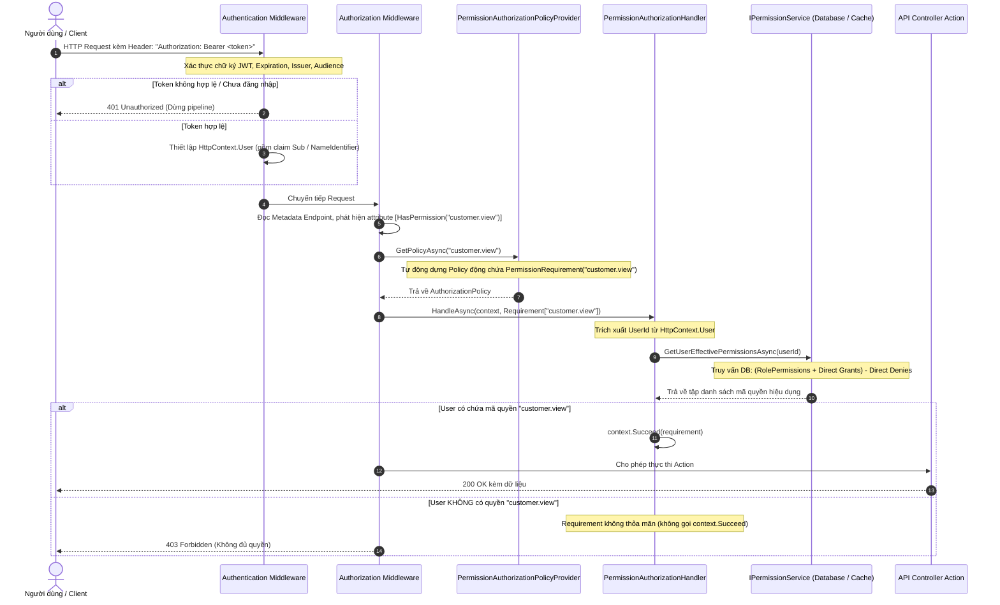

# KẾ HOẠCH TRIỂN KHAI HỆ THỐNG PHÂN QUYỀN ĐỘNG (DYNAMIC PERMISSION)

---

## 1. TỔNG QUAN & NGUYÊN TẮC THIẾT KẾ

Dynamic Permission (Phân quyền động) là chức năng cốt lõi của hệ thống, cho phép kiểm soát quyền truy cập chi tiết đến từng API Endpoint ở mức thời gian thực (Real-time Evaluation).

### Các nguyên tắc bảo mật bắt buộc:
1. **Zero-Trust Client:** Tuyệt đối không nhận quyền từ Client (không nhận từ request body, query params hay request headers). Toàn bộ danh sách quyền của người dùng phải được truy vấn từ Database/Cache tại máy chủ dựa trên `UserId` đã được xác thực an toàn qua chữ ký JWT.
2. **Không lưu Permission vào JWT Payload:** Giúp hệ thống nhận biết các thay đổi phân quyền ngay lập tức (khi admin cấp thêm quyền, tước quyền hoặc khóa vai trò) mà không cần chờ Access Token của người dùng hết hạn.
3. **Phân biệt rõ ràng 401 và 403:**
   * **401 Unauthorized:** Khi người dùng chưa đăng nhập, token không hợp lệ hoặc đã hết hạn.
   * **403 Forbidden:** Khi người dùng đã đăng nhập thành công nhưng không sở hữu quyền cần thiết để thực thi Endpoint.
4. **Không để lộ Endpoint do lỗi cấu hình (Fail-Secure):** `[HasPermission]` bắt buộc người dùng phải đăng nhập trước (`RequireAuthenticatedUser`). Nếu có bất kỳ lỗi nào trong quá trình kiểm tra quyền, mặc định hệ thống sẽ từ chối (`Deny`).
5. **Động hoàn toàn (No Hardcode):** Không đăng ký thủ công từng Policy (`AddPolicy("customer.view", ...)`) trong mã nguồn. Sử dụng `IAuthorizationPolicyProvider` để tự động khởi tạo Policy theo chuỗi Permission Code được khai báo trên Attribute.

---

## 2. CƠ CHẾ HOẠT ĐỘNG CỦA ASP.NET CORE AUTHORIZATION & TÍCH HỢP CUSTOM HANDLER



### Giải thích các thành phần cốt lõi của ASP.NET Core Authorization:

1. **`IAuthorizationRequirement` (`PermissionRequirement`):**
   * Là một đối tượng dữ liệu (Marker / Data contract) đại diện cho điều kiện cần thỏa mãn.
   * Chứa thuộc tính `Permission` (ví dụ: `"customer.view"`, `"order.approve"`).
2. **`AuthorizationHandler<TRequirement>` (`PermissionAuthorizationHandler`):**
   * Là nơi chứa **logic kiểm tra thực tế**.
   * Đọc `UserId` từ `ClaimsPrincipal`.
   * Gọi `IPermissionService` để lấy danh sách quyền hiệu dụng của User.
   * Nếu User có quyền tương ứng $\rightarrow$ gọi `context.Succeed(requirement)`.
   * Nếu không có quyền $\rightarrow$ không gọi `Succeed`, ASP.NET Core sẽ tự động đánh dấu kiểm tra thất bại và trả về HTTP 403.
3. **`IAuthorizationPolicyProvider` (`PermissionAuthorizationPolicyProvider`):**
   * Mặc định trong ASP.NET Core, mỗi Policy phải được cấu hình sẵn bằng `options.AddPolicy("Name", ...)`.
   * Việc có hàng trăm Permission trong hệ thống thực tế sẽ khiến việc khai báo này trở nên bất khả thi.
   * Bằng cách implement `IAuthorizationPolicyProvider` (kế thừa `DefaultAuthorizationPolicyProvider`), khi gặp bất kỳ Policy name nào (ví dụ `"customer.view"`), hệ thống sẽ **tự động sinh Policy theo yêu cầu** kết hợp `RequireAuthenticatedUser()` và `AddRequirements(new PermissionRequirement(permissionName))`.
4. **Custom Attribute (`HasPermissionAttribute`):**
   * Kế thừa từ `AuthorizeAttribute`.
   * Cho phép lập trình viên chỉ cần viết `[HasPermission("customer.view")]` gọn gàng phía trên Controller Action thay vì `[Authorize(Policy = "customer.view")]`.

---

## 3. THIẾT KẾ CHI TIẾT TỪNG TẦNG (CLEAN ARCHITECTURE)

```
src/
├── DynamicPermission.Application/
│   ├── Common/Interfaces/
│   │   └── IPermissionService.cs                # Contract lấy quyền hiệu dụng của User
│   └── Services/
│       └── PermissionService.cs                 # Triển khai thuật toán tính Effective Permissions
│
├── DynamicPermission.Infrastructure/
│   ├── Authorization/
│   │   ├── PermissionRequirement.cs             # Requirement chứa Permission Code
│   │   ├── PermissionAuthorizationHandler.cs     # Handler kiểm tra quyền người dùng
│   │   └── PermissionAuthorizationPolicyProvider.cs # PolicyProvider sinh policy động
│   └── DependencyInjection.cs                   # Đăng ký Handler, PolicyProvider, MemoryCache
│
└── DynamicPermission.API/
    ├── Attributes/
    │   └── HasPermissionAttribute.cs            # Attribute [HasPermission("...")]
    ├── Controllers/
    │   └── DemoController.cs                    # Controller mẫu kiểm thử các Endpoint có bảo vệ quyền
    └── Program.cs                               # Đăng ký quyền và middleware
```

### 3.1. Thuật toán tính quyền hiệu dụng trong `IPermissionService`
Tuân thủ công thức toán học đã thiết kế trong kiến trúc Domain Model:
$$\text{EffectivePermissions} = \left( \text{RolePermissions}(User.Role) \cup \text{UserDirectGrants} \right) \setminus \text{UserDirectDenies}$$

1. Kiểm tra `User.IsActive`: Nếu `false` $\rightarrow$ Trả về danh sách rỗng (mất toàn bộ quyền).
2. Kiểm tra `Role.IsActive`: Nếu `true`, lấy danh sách các mã quyền từ `Role.RolePermissions`. Nếu `false`, bỏ qua quyền kế thừa từ Role.
3. Lấy các quyền override từ `UserPermissions`:
   * Các quyền có `IsGranted == true`: Đưa vào tập hợp cấp thêm (`Union`).
   * Các quyền có `IsGranted == false`: Đưa vào tập hợp tước bỏ (`Except`).
4. **Tối ưu hóa hiệu năng (Caching):**
   * Để tránh truy vấn Database mỗi khi người dùng gọi một API (1 request = 1 DB query kiểm tra quyền), sử dụng `IMemoryCache` với thời gian ngắn (ví dụ: 1 - 2 phút) theo khóa `$"user_perms_{userId}"`.
   * Khi Admin gán thêm quyền hoặc đổi vai trò của User, Cache này sẽ được xóa (Invalidate) ngay lập tức.

---

## 4. KẾ HOẠCH BẢO VỆ CÁC API ENDPOINT

### Cú pháp khai báo trên Controller:
```csharp
[ApiController]
[Route("api/[controller]")]
public class CustomerController : ControllerBase
{
    // Yêu cầu quyền customer.view
    [HttpGet]
    [HasPermission("customer.view")]
    public async Task<IActionResult> GetCustomers()
    {
        return Ok(new[] { "Customer A", "Customer B" });
    }

    // Yêu cầu quyền customer.create
    [HttpPost]
    [HasPermission("customer.create")]
    public async Task<IActionResult> CreateCustomer([FromBody] CreateCustomerDto dto)
    {
        return Ok("Created");
    }

    // Yêu cầu quyền customer.delete
    [HttpDelete("{id}")]
    [HasPermission("customer.delete")]
    public async Task<IActionResult> DeleteCustomer(Guid id)
    {
        return Ok("Deleted");
    }
}
```

---

## 5. KẾ HOẠCH TRIỂN KHAI UNIT TEST

Tạo các test case chuyên biệt trong `tests/DynamicPermission.UnitTests/`:

### 5.1. `PermissionServiceTests` (Kiểm thử logic tính quyền hiệu dụng)
1. `GetUserEffectivePermissions_ShouldReturnRolePermissions_WhenUserAndRoleAreActive`:
   * User có Role `STAFF`, Role có các quyền `customer.view`, `customer.create`.
   * Kết quả: Trả về đúng 2 quyền trên.
2. `GetUserEffectivePermissions_ShouldReturnEmpty_WhenUserIsInactive`:
   * `User.IsActive = false`.
   * Kết quả: Trả về rỗng (0 quyền).
3. `GetUserEffectivePermissions_ShouldExcludeRolePermissions_WhenRoleIsInactive`:
   * `Role.IsActive = false`.
   * Kết quả: Quyền từ Role bị vô hiệu hóa hoàn toàn.
4. `GetUserEffectivePermissions_ShouldIncludeDirectGrant_EvenIfRoleDoesNotHaveIt`:
   * Role không có quyền `customer.export`.
   * Có bản ghi `UserPermission` với `IsGranted = true` cho `customer.export`.
   * Kết quả: Danh sách trả về có chứa `customer.export`.
5. `GetUserEffectivePermissions_ShouldExcludeDirectDeny_EvenIfRoleHasIt`:
   * Role có quyền `customer.delete`.
   * Có bản ghi `UserPermission` với `IsGranted = false` cho `customer.delete`.
   * Kết quả: Danh sách trả về **KHÔNG** chứa `customer.delete` (Deny overrides Allow).

### 5.2. `PermissionAuthorizationHandlerTests` (Kiểm thử Authorization Handler)
1. `HandleRequirement_ShouldSucceed_WhenUserHasRequiredPermission`:
   * User đăng nhập hợp lệ và sở hữu quyền `customer.view`.
   * Kết quả: `context.HasSucceeded == true`.
2. `HandleRequirement_ShouldNotSucceed_WhenUserLacksRequiredPermission`:
   * User đăng nhập nhưng không có quyền `customer.view`.
   * Kết quả: `context.HasSucceeded == false` (dẫn tới 403 Forbidden).
3. `HandleRequirement_ShouldNotSucceed_WhenUserIsNotAuthenticated`:
   * Người dùng chưa đăng nhập (`IsAuthenticated == false`).
   * Kết quả: `context.HasSucceeded == false` (dẫn tới 401 Unauthorized).
4. `HandleRequirement_ShouldNotSucceed_WhenUserIdClaimIsMissing`:
   * Token không có claim `NameIdentifier` / `sub`.
   * Kết quả: `context.HasSucceeded == false`.

### 5.3. `PermissionAuthorizationPolicyProviderTests`
1. `GetPolicyAsync_ShouldCreatePolicyWithPermissionRequirement_ForGivenPermissionCode`:
   * Kiểm tra Policy được sinh ra có chứa `PermissionRequirement` với đúng chuỗi Permission Code.
   * Kiểm tra Policy có ràng buộc `RequireAuthenticatedUser`.

---

## 6. CÁC BƯỚC THỰC HIỆN TRIỂN KHAI

Sau khi kế hoạch được phê duyệt:
1. **Bước 1 (Application):** Tạo `IPermissionService` và triển khai `PermissionService` (tính quyền hiệu dụng từ Database kèm Caching). Đăng ký vào DI.
2. **Bước 2 (Infrastructure):**
   * Xây dựng `PermissionRequirement`.
   * Xây dựng `PermissionAuthorizationHandler`.
   * Xây dựng `PermissionAuthorizationPolicyProvider`.
   * Đăng ký `IAuthorizationHandler` và `IAuthorizationPolicyProvider` trong `DependencyInjection.cs`.
3. **Bước 3 (API):**
   * Xây dựng `[HasPermission("...")]` Attribute.
   * Tạo Controller mẫu `DemoController` với các action được bảo vệ bằng `[HasPermission]`.
4. **Bước 4 (Unit Test):**
   * Triển khai `PermissionServiceTests`.
   * Triển khai `PermissionAuthorizationHandlerTests`.
   * Triển khai `PermissionAuthorizationPolicyProviderTests`.
   * Chạy `dotnet test` đảm bảo toàn bộ tests Passed.
5. **Bước 5:** Báo cáo kết quả và cung cấp ví dụ test API có phân quyền qua cURL / Swagger.
